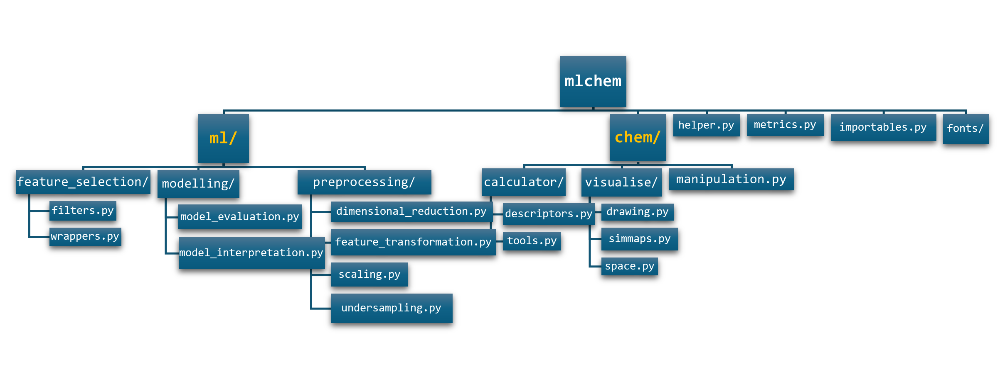
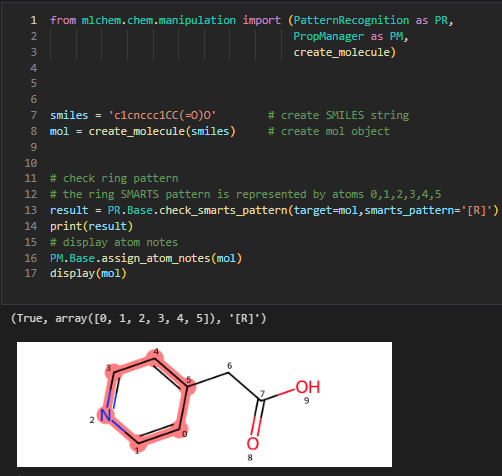
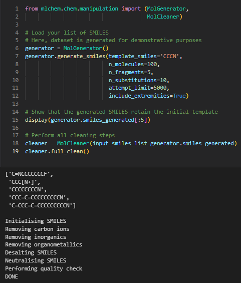
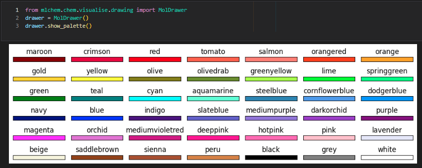

# mlchem

[](https://www.python.org/)
[](https://www.rdkit.org/)
[](https://github.com/seacunilever/mlchem/blob/master/assets/coverage.svg)
[](https://github.com/seacunilever/mlchem/blob/master/assets/coverage-branch.svg)

**mlchem** is a Python cheminformatics library designed for the scientific community. It provides a comprehensive set of tools for data handling, molecule manipulation, drawing, machine learning, and plotting.

## Documentation

Available at [seacunilever.github.io/mlchem](https://seacunilever.github.io/mlchem/).
Start with the [Quickstart](#quickstart), browse the [API reference](https://seacunilever.github.io/mlchem/modules.html), or read the [architecture guide](https://seacunilever.github.io/mlchem/architecture.html).

## Features

- **Data Handling**: Efficiently manage and process chemical data, including loading, cleaning, and transforming datasets.
- **Molecule Manipulation**: Tools for manipulating molecular structures, such as adding or removing atoms, modifying bonds, and generating molecular conformations.
- **Pattern Recognition**: An extensive list of functions to search for specific structural patterns.
- **Molecule Drawing**: Visualise molecules with customisable drawing options, creating high-quality images for presentations and publications.
- **Machine Learning**: Implement machine learning models for cheminformatics, including training, evaluating, and deploying models to predict chemical properties and activities.
- **Feature Analysis and Interpretation**: Interpret model features and provide insightful plots.

## Architecture



For package responsibilities and the typical data flow, see the [architecture guide](https://seacunilever.github.io/mlchem/architecture.html).


## Installation

To install **mlchem**, open your command prompt and use either:

```bash
pip install git+https://github.com/seacunilever/mlchem.git
```

or, from PyPI:

```bash
pip install mlchem-ul
```

Then import in Python as:

```python
import mlchem
```

## Quickstart

This end-to-end example turns SMILES into Morgan fingerprints and evaluates a
classifier with cross-validated ROC-AUC. The labels are toy values to
demonstrate the API, not experimental measurements; replace them with a
validated target for real modeling.

```python
from sklearn.ensemble import RandomForestClassifier
from sklearn.metrics import roc_auc_score

from mlchem.chem.calculator.descriptors import get_fingerprint_df
from mlchem.ml.modelling.model_evaluation import crossval

smiles = [
    'CCO', 'CCCO', 'CC(C)O', 'CCCCO',
    'CCN', 'CCCN', 'CC(C)N', 'CCCCN',
    'c1ccccc1', 'Cc1ccccc1', 'c1ccncc1', 'c1ccoc1',
]
y = [0, 0, 0, 0, 1, 1, 1, 1, 0, 0, 1, 1]

X = get_fingerprint_df(smiles, fp_type='m', radius=2, nBits=256)
scores = crossval(
    estimator=RandomForestClassifier(n_estimators=20, random_state=42),
    X=X,
    y=y,
    metric=roc_auc_score,
    n_fold=3,
    task_type='classification',
    shuffle=True,
    random_state=42,
    response_method='predict_proba',
)

print(f"Mean CV ROC-AUC: {scores['cv_mean']:.3f}")
```

See the [`get_fingerprint_df` API](https://seacunilever.github.io/mlchem/mlchem.chem.calculator.html#mlchem.chem.calculator.descriptors.get_fingerprint_df)
for fingerprint options and the
[`crossval` API](https://seacunilever.github.io/mlchem/mlchem.ml.modelling.html#mlchem.ml.modelling.model_evaluation.crossval)
for splitters, explicit folds, and response methods.

## Usage

Here are some basic examples of how to use **mlchem**:

### Calculate RDKit descriptors

See the [`get_rdkitDesc` API](https://seacunilever.github.io/mlchem/mlchem.chem.calculator.html#mlchem.chem.calculator.descriptors.get_rdkitDesc).

```python
from mlchem.chem.manipulation import create_molecule
from mlchem.chem.calculator import descriptors
mol1 = create_molecule('c1ccccc1CCCO')
mol2 = create_molecule('CCCCCN')
desc_df = descriptors.get_rdkitDesc([mol1, mol2],include_3D=True)
```

### Calculate fingerprints

See the [`get_fingerprint_df` API](https://seacunilever.github.io/mlchem/mlchem.chem.calculator.html#mlchem.chem.calculator.descriptors.get_fingerprint_df)
and the single-molecule
[`get_fingerprint` API](https://seacunilever.github.io/mlchem/mlchem.chem.calculator.html#mlchem.chem.calculator.descriptors.get_fingerprint).

```python
from mlchem.chem.calculator import descriptors

smiles_list = ['CCO', 'CCN', 'CCC']

# Morgan bit-vectors (default configuration is radius=2 and nBits=2048)
fp_df = descriptors.get_fingerprint_df(smiles_list, fp_type='m', radius=2, nBits=2048)

# Include bit info for interpretability on a single molecule
fp, bit_info = descriptors.get_fingerprint('CCO', fp_type='m', radius=2, nBits=2048, include_bit_info=True)
```

### Calculate chemotypes at scale

See the [`get_chemotypes` API](https://seacunilever.github.io/mlchem/mlchem.chem.calculator.html#mlchem.chem.calculator.descriptors.get_chemotypes).

```python
from mlchem.chem.calculator import descriptors

smiles_list = ['CCO', 'CCN', 'COCC', 'c1ccccc1O']

# n_jobs=1 keeps serial execution (default)
# n_jobs>1 enables multi-threaded molecule processing
# n_jobs=-1 uses all available CPU cores
chemotypes = descriptors.get_chemotypes(smiles_list, n_jobs=4)
```

Performance note: since v1.1.0, chemotype execution reuses per-molecule rule results
and avoids repeated molecule preparation. This is especially important for
large rule dictionaries and medium-to-large training sets.

### Control ML Verbosity

See the
[`SequentialForwardSelection` API](https://seacunilever.github.io/mlchem/mlchem.ml.feature_selection.html#mlchem.ml.feature_selection.wrappers.SequentialForwardSelection)
and
[`CombinatorialSelection` API](https://seacunilever.github.io/mlchem/mlchem.ml.feature_selection.html#mlchem.ml.feature_selection.wrappers.CombinatorialSelection).

```python
import logging
from sklearn.linear_model import LogisticRegression
from mlchem.ml.feature_selection.wrappers import (
  SequentialForwardSelection,
  CombinatorialSelection,
)

# Enable library logs in your notebook session
logging.basicConfig(level=logging.INFO)

sfs = SequentialForwardSelection(
  estimator=LogisticRegression(),
  estimator_string='lr',
  metric=lambda y_true, y_pred: (y_true == y_pred).mean(),
  log_level='INFO',
)

# Runtime toggle (use DEBUG for very verbose traces)
sfs.set_log_level('DEBUG')
sfs.set_log_level('WARNING')

cs = CombinatorialSelection(
  estimator=LogisticRegression(),
  metric=lambda y_true, y_pred: (y_true == y_pred).mean(),
  log_level='INFO',
)
```

### Balance an imbalanced training set

See the
[`undersample` API](https://seacunilever.github.io/mlchem/mlchem.ml.preprocessing.html#mlchem.ml.preprocessing.undersampling.undersample)
for input requirements and examples.

The `class_column` must exist in `train_set`. It is also required in `test_set` when `add_dropped_to_test=True`; otherwise, the test-set target column is not accessed. Invalid target proportions and non-binary training labels raise `ValueError`; missing required columns raise `KeyError` with the missing column names.

```python
from mlchem.ml.preprocessing.undersampling import undersample

train_balanced, test_updated = undersample(
  train_set=train_df,
  test_set=test_df,
  class_column='class',
  desired_proportion_majority=0.5,
  log_level='INFO',
)
```

### Stress-Test Models with Y-Scrambling

See the
[`y_scrambling` API](https://seacunilever.github.io/mlchem/mlchem.ml.modelling.html#mlchem.ml.modelling.model_evaluation.y_scrambling)
for split, metric, and response-method options.

```python
from mlchem.ml.modelling.model_evaluation import y_scrambling

y_scrambling(
  estimator=model,
  train_set=X_train,
  y_train=y_train,
  metric=metric_fn,
  n_scrambles=50,
  safety_multiplier=2.3,
  plot=False,
  log_level='INFO',
)
```

Returned diagnostics include:
- `reference_score`
- `best_random_score`
- `probability_better`
- `safety_margin_ratio`

### Cross-Validation Majority Voting

See
[`MajorityVote.evaluate_cv`](https://seacunilever.github.io/mlchem/mlchem.ml.modelling.html#mlchem.ml.modelling.model_evaluation.MajorityVote.evaluate_cv)
for soft-vote probabilities, fold definitions, and reliability ranking.

```python
from sklearn.linear_model import LogisticRegression
from sklearn.ensemble import RandomForestClassifier
from mlchem.metrics import get_geometric_S
from mlchem.ml.modelling.model_evaluation import MajorityVote, generate_cv_indices

estimators = [
  LogisticRegression(random_state=1),
  RandomForestClassifier(random_state=1),
]

columns = [
  X_train.columns.tolist(),
  X_train.columns.tolist(),
]

mv = MajorityVote(
  train_set=X_train,
  y_train=y_train,
  task_type='classification',
  estimator_list=estimators,
  column_list=columns,
  estimator_names=['LR', 'RF'],
)

folds = generate_cv_indices(
  X_train.values,
  y=y_train,
  cv_iter=5,
  task_type='classification',
  shuffle=True,
  random_state=42,
)

df_mv = mv.evaluate_cv(
  metric=get_geometric_S,
  metric_name='G',
  cv_indices=folds,
  logic='greater',
  desired_performance_score='train_cv_average',
)

# Ranked by reliability_mean (descending)
print(df_mv[['combination', 'validation_mean', 'reliability_mean']].head())

# Final consensus stage: fit shortlisted estimators on full train set
# and generate train/test prediction tables.

fit_report = mv.fit(return_prediction_dataframes=True)
```

`fit()` is the final consensus step after model selection.

### Capture pipeline logs

Library messages are emitted at `INFO` level by default. Configure a selector's
`log_level` as shown above, or capture logs from an entire pipeline in memory
or a file:

```python
from mlchem.helper import start_logging

logs = start_logging(log_level='INFO', to_console=True)
sfs.fit(X_train, y_train, X_test, y_test)
print(logs.get_logs())

# To log to a file instead:
# logs = start_logging(log_level='INFO', to_file='pipeline.log')
# sfs.fit(X_train, y_train, X_test, y_test)
```

### Visual examples

#### Pattern recognition

See the [molecule manipulation API](https://seacunilever.github.io/mlchem/mlchem.chem.html#module-mlchem.chem.manipulation)
for pattern-recognition utilities.



#### De novo molecule generation and cleaning

See the [molecule manipulation API](https://seacunilever.github.io/mlchem/mlchem.chem.html#module-mlchem.chem.manipulation)
for molecule creation and generation utilities.



#### Predefined colour palette

See the [drawing API](https://seacunilever.github.io/mlchem/mlchem.chem.visualise.html#module-mlchem.chem.visualise.drawing)
for drawing and palette options.




More examples in the [examples](https://github.com/seacunilever/mlchem/tree/master/examples) folder.

## Modules

Browse the API by package:

### chem.visualise/

- **[space.py API](https://seacunilever.github.io/mlchem/mlchem.chem.visualise.html#module-mlchem.chem.visualise.space)**:
  Computes and visualises datasets in a lower-dimensional space.
- **[simmaps.py API](https://seacunilever.github.io/mlchem/mlchem.chem.visualise.html#module-mlchem.chem.visualise.simmaps)**:
  Generates "rdkit-like" similarity maps based on atomic importance weights.
- **[drawing.py API](https://seacunilever.github.io/mlchem/mlchem.chem.visualise.html#module-mlchem.chem.visualise.drawing)**:
  Handles the drawing of molecular structures with many customisable options.

### chem.calculator/

- **[tools.py API](https://seacunilever.github.io/mlchem/mlchem.chem.calculator.html#module-mlchem.chem.calculator.tools)**:
  Provides tools for chemical calculations.
- **[descriptors.py API](https://seacunilever.github.io/mlchem/mlchem.chem.calculator.html#module-mlchem.chem.calculator.descriptors)**:
  Calculates RDKit and Mordred descriptors, chemotypes, fingerprints, and
  other molecular features. Start with
  [`get_fingerprint_df`](https://seacunilever.github.io/mlchem/mlchem.chem.calculator.html#mlchem.chem.calculator.descriptors.get_fingerprint_df)
  or
  [`get_rdkitDesc`](https://seacunilever.github.io/mlchem/mlchem.chem.calculator.html#mlchem.chem.calculator.descriptors.get_rdkitDesc).

### chem.manipulation.py

The [`mlchem.chem.manipulation` API](https://seacunilever.github.io/mlchem/mlchem.chem.html#module-mlchem.chem.manipulation)
provides molecule creation, conversion, manipulation, and pattern-recognition
utilities. See
[`create_molecule`](https://seacunilever.github.io/mlchem/mlchem.chem.html#mlchem.chem.manipulation.create_molecule)
to get started.

### ml.feature_selection/

- **[filters.py API](https://seacunilever.github.io/mlchem/mlchem.ml.feature_selection.html#module-mlchem.ml.feature_selection.filters)**:
  Provides filter-based feature selection.
- **[wrappers.py API](https://seacunilever.github.io/mlchem/mlchem.ml.feature_selection.html#module-mlchem.ml.feature_selection.wrappers)**:
  Includes
  [`SequentialForwardSelection`](https://seacunilever.github.io/mlchem/mlchem.ml.feature_selection.html#mlchem.ml.feature_selection.wrappers.SequentialForwardSelection)
  and
  [`CombinatorialSelection`](https://seacunilever.github.io/mlchem/mlchem.ml.feature_selection.html#mlchem.ml.feature_selection.wrappers.CombinatorialSelection).

### ml.modelling/

- **[model_interpretation.py API](https://seacunilever.github.io/mlchem/mlchem.ml.modelling.html#module-mlchem.ml.modelling.model_interpretation)**:
  Provides tools for interpreting machine learning models.
- **[model_evaluation.py API](https://seacunilever.github.io/mlchem/mlchem.ml.modelling.html#module-mlchem.ml.modelling.model_evaluation)**:
  Includes
  [`crossval`](https://seacunilever.github.io/mlchem/mlchem.ml.modelling.html#mlchem.ml.modelling.model_evaluation.crossval),
  [`y_scrambling`](https://seacunilever.github.io/mlchem/mlchem.ml.modelling.html#mlchem.ml.modelling.model_evaluation.y_scrambling),
  and
  [`MajorityVote.evaluate_cv`](https://seacunilever.github.io/mlchem/mlchem.ml.modelling.html#mlchem.ml.modelling.model_evaluation.MajorityVote.evaluate_cv).

### ml.preprocessing/

- **[dimensional_reduction.py API](https://seacunilever.github.io/mlchem/mlchem.ml.preprocessing.html#module-mlchem.ml.preprocessing.dimensional_reduction)**:
  Compresses dataframes using dimensionality-reduction techniques.
- **[feature_transformation.py API](https://seacunilever.github.io/mlchem/mlchem.ml.preprocessing.html#module-mlchem.ml.preprocessing.feature_transformation)**:
  Expands features with
  [`polynomial_expansion`](https://seacunilever.github.io/mlchem/mlchem.ml.preprocessing.html#mlchem.ml.preprocessing.feature_transformation.polynomial_expansion).
- **[scaling.py API](https://seacunilever.github.io/mlchem/mlchem.ml.preprocessing.html#module-mlchem.ml.preprocessing.scaling)**:
  Scales dataframes with standard, min-max, and robust scaling, including
  [`scale_df_standard`](https://seacunilever.github.io/mlchem/mlchem.ml.preprocessing.html#mlchem.ml.preprocessing.scaling.scale_df_standard).
- **[undersampling.py API](https://seacunilever.github.io/mlchem/mlchem.ml.preprocessing.html#module-mlchem.ml.preprocessing.undersampling)**:
  Handles imbalanced datasets.

## Development setup

Clone the repository, create and activate a virtual environment, then install
the package in editable mode with its requirements:

```bash
git clone https://github.com/seacunilever/mlchem
cd mlchem
python -m venv _venv

# Activate on macOS/Linux:
source _venv/bin/activate

# Activate on Windows (PowerShell):
.\_venv\Scripts\Activate.ps1

# Activate on Windows (cmd.exe):
_venv\Scripts\activate.bat

pip install -r requirements.txt
pip install -e .
```

## Contributing

We welcome contributions to **mlchem**. Please consult the
[contribution guide](https://github.com/seacunilever/mlchem/blob/master/CONTRIBUTING.md)
for how to propose changes, report bugs, and submit pull requests.

## Testing and Maintainer Guide

Python 3.12, 3.13, and 3.14 are supported and all are required to pass in CI.
For routine development, run the tests from the repository root:

```bash
python -m pytest -vv tests
```

Activate the project virtual environment before running the commands below.
The local matrix runner expects existing environments such as `py312`, `py313`,
and `py314` under `~/Envs`; if you use a different setup, use tox instead.

### Local matrix testing

Run the supported Python versions:

```bash
python scripts/run_local_matrix.py
```

Useful options:

- `--refresh-badges` runs the matrix and refreshes the local coverage badges.
- `--full-install -- -vv tests` reinstalls dependencies before testing.
- `--no-live-output -- -vv tests` prints only the final summary.
- `--allow-314-failure -- -vv tests` treats Python 3.14 failures as warnings
  for exploratory local runs only; normal runs and CI remain blocking.

On Windows, use `py -u scripts/run_local_matrix.py` if output appears buffered.
Tox is an alternative when the matrix runner's environment layout does not fit:

```bash
python -m pip install tox
python -m tox -e py312,py313,py314
```

Tox skips interpreters that are unavailable locally. CI installs Python 3.14
and requires it to pass.

### Warning and coverage checks

A narrowly scoped pytest warning filter suppresses an upstream SHAP
`PendingDeprecationWarning` related to matplotlib colormap API changes. To audit
all warnings explicitly, run:

```bash
python -m pytest -vv tests -W default
```

The canonical coverage baseline uses Python 3.12, matching the CI `py312` job:

```bash
python -m pytest -q tests --cov=mlchem --cov-config=.coveragerc --cov-branch --cov-report=term --cov-report=xml:coverage.xml
python - <<'PY'
import xml.etree.ElementTree as ET
root = ET.parse('coverage.xml').getroot()
line_pct = round(float(root.get('line-rate', 0.0)) * 100)
branch_pct = round(float(root.get('branch-rate', 0.0)) * 100)
print(f'line={line_pct}, branch={branch_pct}')
PY
python -m anybadge --label "line cov" --value <LINE_PERCENT> --file assets/coverage.svg --overwrite 50=red 60=orange 70=yellow 80=yellowgreen 90=green
python -m anybadge --label "branch cov" --value <BRANCH_PERCENT> --file assets/coverage-branch.svg --overwrite 50=red 60=orange 70=yellow 80=yellowgreen 90=green
```

Line coverage measures which executable lines ran; branch coverage also
measures whether the outcomes of conditional logic were exercised. CI does not
update the badges; maintainers refresh and commit them locally.

### Release refresh

1. Update `version=` in `setup.py`.
2. Run the local matrix with `--refresh-badges` as described above.
3. [Build and publish the documentation](#building-the-documentation).
4. Commit the code, tests, documentation, and refreshed badges.

## Building the Documentation

The documentation is built with [Sphinx](https://www.sphinx-doc.org/) using `autodoc`, [`myst-parser`](https://myst-parser.readthedocs.io/), and `viewcode`. Source files live under `docs/source/`, build output lands in `docs/build/html/`, and a small post-build script (`docs/_publish.py`) mirrors that build into `docs/` so GitHub Pages always serves the latest version. `viewcode` adds source links to documented modules, classes, and methods.

> Single-source content: `docs/source/welcome.md` `{include}`s this README, so you only edit `README.md` — never duplicate content into the welcome page.

### Tracked and Generated Files

Only the inputs and the published output are tracked in git:

- **Tracked (do edit / commit)**
  - `docs/source/` — Sphinx inputs (`conf.py`, `*.rst`, `welcome.md`, `_static/custom.css`).
  - `docs/Makefile`, `docs/make.bat`, `docs/_publish.py` — build entry points.
  - `docs/.nojekyll` — tells GitHub Pages to keep `_static/`, `_sources/`, and `_modules/`.
  - `docs/*.html`, `docs/_static/`, `docs/_sources/`, `docs/_images/`, `docs/_modules/`, `docs/objects.inv`, `docs/searchindex.js` — the **published mirror** that GitHub Pages serves; updated automatically by `make html` via `_publish.py`.
- **Not tracked (regenerated on every build, ignored via `.gitignore`)**
  - `docs/build/` — Sphinx scratch output, including `build/html/.doctrees/` and `build/html/.buildinfo` incremental-build caches.
  - `docs/*warnings*.{log,txt}` — ad-hoc diagnostic logs.

### Prerequisites

The documentation toolchain is part of `requirements.txt`. If you only want the doc deps:

```bash
pip install sphinx myst-parser
```

### Build and Publish

Run these commands from the `docs/` directory, not `docs/source/`:

```bash
# wipe previous build artefacts (clears docs/build/)
make clean

# build HTML and automatically mirror docs/build/html/ -> docs/
make html
```

`make html` runs Sphinx and then invokes `_publish.py`, which:

1. updates changed files and removes stale published assets at the root of `docs/` (everything except `source/`, `build/`, `Makefile`, `make.bat`, `_publish.py`, `.nojekyll`, `.gitignore`);
2. ensures the `.nojekyll` marker is present so GitHub Pages keeps `_static/`, `_sources/`, and `_modules/`.

Unchanged files are left in place, avoiding unnecessary replacement of files
that may be open on Windows. If a changed file is locked, close the application
using it and rerun `make html`. Commit the regenerated files at the root of
`docs/`; `docs/build/` stays local.

If you ever build with a raw `sphinx-build` invocation, run the mirror step manually:

```bash
make publish
```

On Windows the same targets are dispatched through `make.bat`, so the commands work in both `cmd` and PowerShell as long as `sphinx-build` and `python` are on the `PATH`.

> Common pitfalls: running `make html` from `docs/source/` (no `Makefile` there → "no rule" / "missing Makefile" error), or typing `make build` (the Sphinx target is `html`; `build` is the *output directory*, not a target).

## Third-Party Dependencies

This project uses the [SELFIES](https://github.com/aspuru-guzik-group/selfies) Python package for molecular string representations.  
SELFIES is licensed under the [Apache License 2.0](https://www.apache.org/). In accordance with its license, the relevant license is included in this repository.

This project uses and adapts code from the [RDKit](https://www.rdkit.org) cheminformatics toolkit, which is licensed under the [BSD 3-Clause License](https://interoperable-europe.ec.europa.eu/licence/bsd-3-clause-clear-license).

## License

This project is licensed under the BSD-3 License.

## Acknowledgements

Special thanks to the Safety, Environmental & Regulatory Science (SERS) Department at Unilever.
